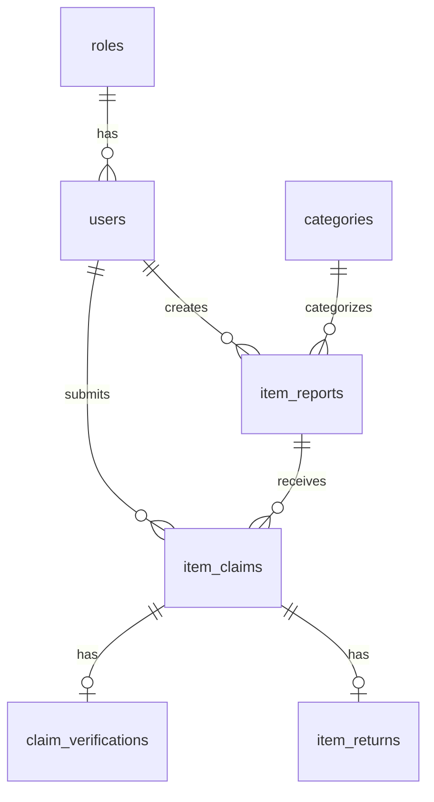

# FoundNear — Lost and Found Management System

## 1. Deskripsi Sistem

**FoundNear** merupakan sistem pengelolaan barang hilang dan ditemukan berbasis RESTful API yang dikembangkan menggunakan bahasa pemrograman Go.

Sistem ini bertujuan membantu pengguna dalam melaporkan barang hilang maupun barang yang ditemukan, mencari informasi barang, mengajukan klaim kepemilikan, serta melakukan proses verifikasi dan pengembalian barang.

FoundNear menyediakan tiga jenis role pengguna, yaitu Admin, Officer, dan User. Setiap role memiliki hak akses yang berbeda sesuai tanggung jawabnya dalam pengelolaan barang hilang dan ditemukan.

## 2. Role dan Hak Akses

| Role | Hak Akses Utama |
|---|---|
| Admin | Mengelola pengguna, kategori, serta mengawasi pengelolaan laporan dan proses klaim. |
| Officer | Mengelola dan memverifikasi laporan serta klaim barang, termasuk pencatatan pengembalian barang. |
| User | Melakukan registrasi dan login, membuat laporan barang hilang atau ditemukan, mencari laporan, mengajukan klaim, dan membatalkan klaim. |

## 3. Fitur Sistem

| No. | Fitur | Role |
|---|---|---|
| 1 | Registrasi dan login | Semua |
| 2 | Pengelolaan laporan barang hilang dan ditemukan | User |
| 3 | Melihat dan mencari laporan barang | User |
| 4 | Filter laporan berdasarkan informasi barang | User |
| 5 | Pengajuan klaim kepemilikan barang | User |
| 6 | Pembatalan pengajuan klaim | User |
| 7 | Verifikasi dan persetujuan atau penolakan klaim | Officer |
| 8 | Pencatatan pengembalian barang | Officer |
| 9 | Pengelolaan pengguna dan kategori | Admin |

## 4. Rancangan Database

FoundNear menggunakan PostgreSQL sebagai sistem manajemen basis data dengan tujuh tabel utama.

| No. | Tabel | Informasi Utama | Relasi |
|---|---|---|---|
| 1 | roles | Data role pengguna | Satu role dapat dimiliki banyak user. |
| 2 | users | Data pengguna dan password hash | Setiap user memiliki satu role dan dapat membuat banyak laporan. |
| 3 | categories | Data kategori barang | Satu kategori dapat digunakan oleh banyak laporan. |
| 4 | item_reports | Data laporan barang hilang dan ditemukan | Setiap laporan berkaitan dengan satu user dan satu kategori. |
| 5 | item_claims | Data pengajuan klaim barang | Setiap klaim berkaitan dengan satu laporan dan satu user. |
| 6 | claim_verifications | Data hasil verifikasi klaim | Setiap verifikasi berkaitan dengan satu klaim. |
| 7 | item_returns | Data pengembalian barang | Setiap pengembalian berkaitan dengan satu klaim. |

### Entity Relationship Diagram (ERD)



### Status Data

**Status Laporan:**
- `active`
- `matched`
- `returned`
- `closed`

**Status Klaim:**
- `pending`
- `approved`
- `rejected`
- `cancelled`

**Hasil Verifikasi:**
- `approved`
- `rejected`

## 5. Arsitektur Sistem

FoundNear dikembangkan menggunakan pendekatan **Clean Architecture** dengan pemisahan tanggung jawab pada setiap bagian project.

Struktur folder project:

```text
foundnear/
├── app/
│   ├── model/
│   ├── repository/
│   └── service/
├── config/
├── database/
├── helper/
├── logs/
├── middleware/
├── route/
├── migrations/
├── main.go
├── go.mod
├── go.sum
└── .env.example
```

Keterangan:
- `app/model`: Menyimpan entity dan struktur data.
- `app/repository`: Mengelola akses dan query database.
- `app/service`: Mengelola proses bisnis dan layanan aplikasi.
- `config`: Menyimpan konfigurasi aplikasi dan environment.
- `database`: Mengelola koneksi PostgreSQL.
- `helper`: Menyimpan fungsi bantuan.
- `middleware`: Mengelola autentikasi, otorisasi, dan middleware lainnya.
- `route`: Mengatur endpoint RESTful API.
- `migrations`: Menyimpan file migrasi database.
- `main.go`: Titik awal menjalankan aplikasi.

## 6. Teknologi yang Digunakan

| Teknologi | Kegunaan |
|---|---|
| Go | Bahasa pemrograman backend |
| Fiber v2 | Framework RESTful API |
| PostgreSQL | Sistem manajemen database |
| pgx/v5 | Driver dan connection pool PostgreSQL |
| JWT | Autentikasi pengguna |
| bcrypt | Pengamanan password |
| Git | Version control |
| GitHub | Kolaborasi dan pengelolaan repository |

## 7. Endpoint API

API FoundNear menggunakan prefix `/api/v1`.

### Authentication

| Method | Endpoint | Keterangan |
|---|---|---|
| POST | `/api/v1/auth/register` | Registrasi pengguna |
| POST | `/api/v1/auth/login` | Login pengguna |
| GET | `/api/v1/auth/me` | Mengambil profil pengguna |

Endpoint lainnya mencakup pengelolaan laporan, pencarian barang, pengajuan klaim, verifikasi klaim, dan pengembalian barang.

## 8. Konfigurasi dan Menjalankan Project

### Prasyarat

- Go
- PostgreSQL
- Git

### Langkah Instalasi

1. Clone repository:

```bash
git clone https://github.com/saniaaww/foundnear.git
```

2. Masuk ke folder project:

```bash
cd foundnear
```

3. Unduh dependency:

```bash
go mod tidy
```

4. Salin `.env.example` menjadi `.env`, kemudian sesuaikan konfigurasi database dan JWT.

5. Buat database PostgreSQL dengan nama `foundnear` dan jalankan file migration sesuai urutan.

6. Jalankan aplikasi:

```bash
go run main.go
```

Secara default, aplikasi berjalan pada port `3000`.

### Konfigurasi Environment

Variabel environment yang digunakan:

```env
APP_NAME=FoundNear
APP_PORT=3000
APP_ENV=development

DB_HOST=localhost
DB_PORT=5432
DB_USER=postgres
DB_PASSWORD=your_password
DB_NAME=foundnear
DB_SSLMODE=disable

JWT_SECRET=your_secret_key
```

**Catatan:** File `.env` asli tidak boleh diunggah ke repository GitHub. Gunakan `.env.example` sebagai contoh konfigurasi.

## 9. Pembagian Tugas Anggota

| Anggota | Peran | Tanggung Jawab |
|---|---|---|
| Saniyatul Warda | Git Master dan Project Setup | Inisialisasi project, konfigurasi, koneksi database, middleware, autentikasi, dan integrasi repository. |
| Edgina Cybil | Database Developer | Perancangan database, migration, model, repository, query, dan pengujian database. |
| Aldha Zahro M | Backend Developer | Pengelolaan laporan barang, pencarian, klaim, verifikasi, dan pengembalian barang. |

## 10. Kolaborasi Pengembangan

Pengembangan FoundNear dilakukan secara berkelompok menggunakan GitHub.

Setiap anggota mengerjakan bagian sesuai tanggung jawab masing-masing melalui branch pengembangan. Perubahan kode dilakukan secara bertahap menggunakan metode **micro commits**, yaitu commit kecil yang memiliki tujuan perubahan yang jelas.

Setiap anggota mengajukan Pull Request (PR) untuk diperiksa oleh Git Master sebelum digabungkan ke branch utama (`main`). Proses ini membantu menjaga kualitas kode dan memastikan integrasi antarbagian sistem berjalan dengan baik.

---

**Repository:** https://github.com/saniaaww/foundnear

**Project:** FoundNear — Lost and Found Management System

**Stack:** Go, Fiber v2, PostgreSQL, JWT, bcrypt
